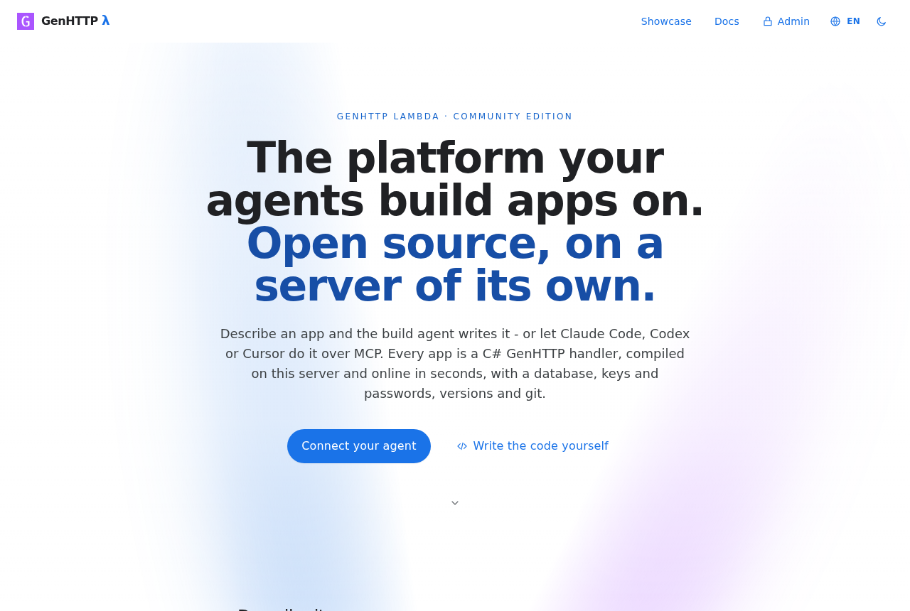
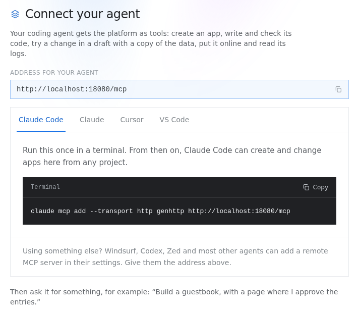
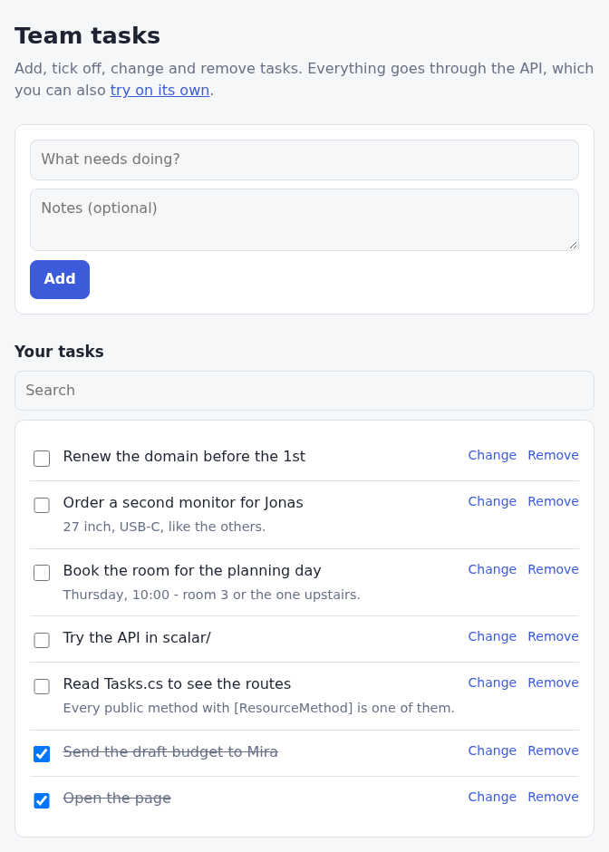
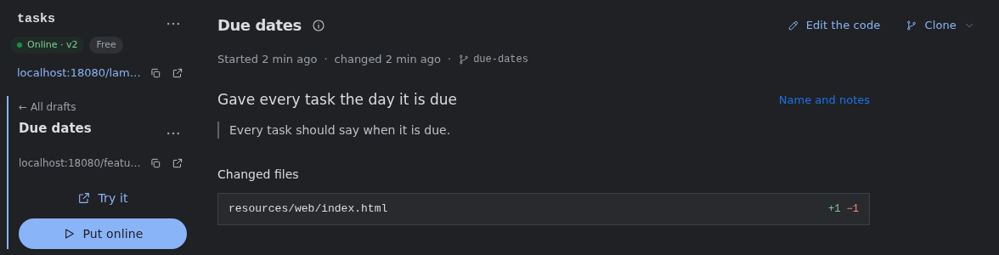
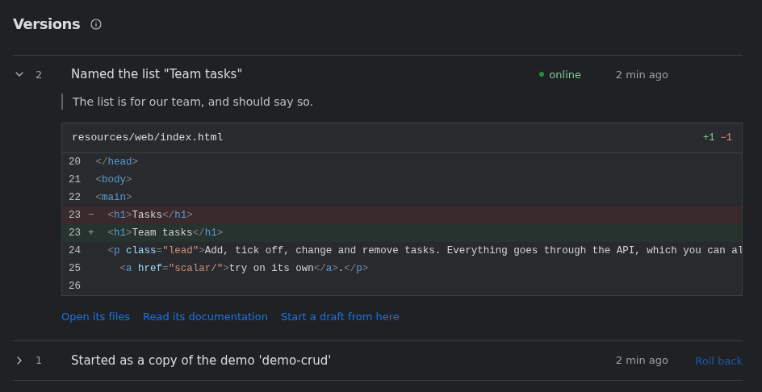
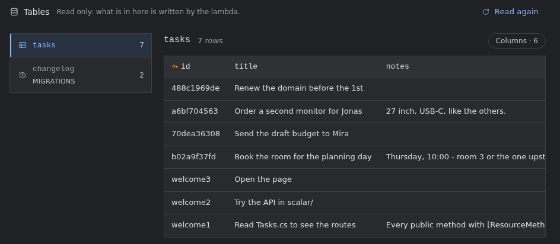
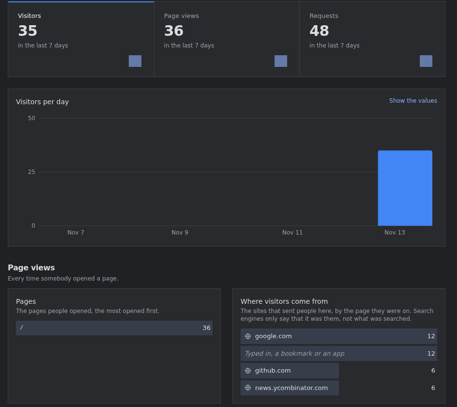
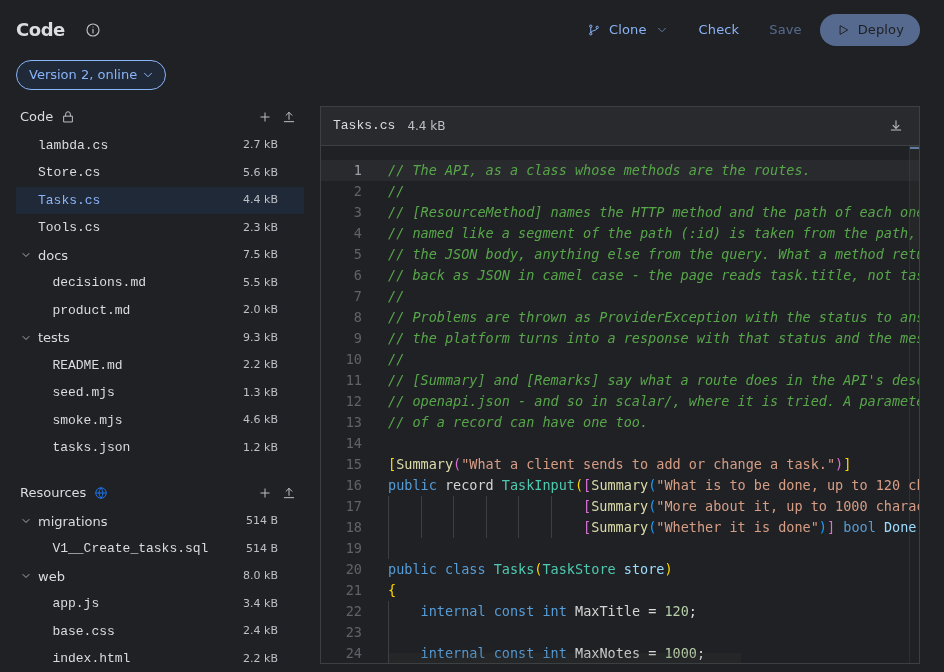
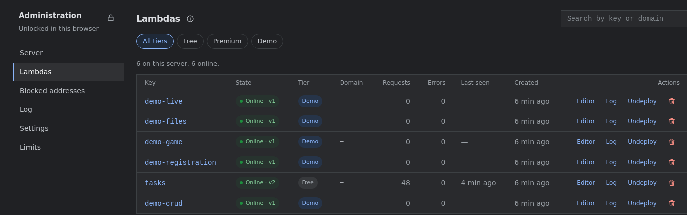

# GenHTTP Lambda

[](https://genhttp.dev/)
[](https://community.genhttp.run/)
[](https://hub.docker.com/r/genhttp/lambda)

**Self-hosted hosting for the apps your coding agent builds.**

Claude Code, Codex or Cursor write a small app in minutes. Getting it online is
what takes the evening: a container, a port, an entry in the reverse proxy, a
database, a backup - and all of it again for the next one. GenHTTP Lambda is
the place on your server where those apps live. Connect your agent once, and
every app it builds is online at an address of its own seconds later, with a
database, versions and a way back. You look after one container.

```bash
docker run -d -p 8080:8080 -v lambda-data:/data -e LAMBDA_ADMIN_TOKEN=secure-password genhttp/lambda
```

That is the whole setup. Open <http://localhost:8080>.



## Why you might want it

- **One container, nothing else.** No database server, no Redis, no message
  queue, no Kubernetes: the server, every app and everything they keep run in
  one container and live in one volume. Backing up is copying a folder.
- **Hundreds of apps, not one.** Every app runs inside that one process, at an
  address of its own - no container, no port, no proxy entry and no database
  server per app. [genhttp.dev](https://genhttp.dev), which runs this same
  code, serves more than a hundred apps that way.
- **Your agent does the deploying.** Connect any agent that speaks MCP. It
  creates an app, writes and checks its code, tries a change on a copy, puts
  it online and reads its logs - without you opening a terminal.
- **You stay in control.** Every app has an editor for you: what changed and
  why, any earlier version one click away, its records, its visitors, its code.

## What people build with it

The small apps that never get hosted because hosting them is more work than
writing them:

- a chore list for the family, a booking page for the club, a sign-up sheet
  for the team;
- a dashboard over an API you use, a webhook receiver for your automations, a
  small API your scripts call;
- a page for an event, a guestbook, a poll, a multiplayer game for friends.

Ask your agent - *"Build a shared task list for the team"* - and it is online.
Ask for a change - *"Give every task the day it is due"* - and it is tried in a
draft first.

## A look around

<table>
  <tr>
    <td width="50%" valign="top"><br><sub><b>Connect your agent</b> - one line for Claude Code, the address for any other MCP client.</sub></td>
    <td width="50%" valign="top"><br><sub><b>An app it built</b> - online at its own address, here <code>/lambda/tasks/</code>.</sub></td>
  </tr>
  <tr>
    <td valign="top"><br><sub><b>Drafts</b> - a change is tried with a copy of the data and a link of its own, then put online.</sub></td>
    <td valign="top"><br><sub><b>Versions</b> - what every change did and why, and a way back to any of them.</sub></td>
  </tr>
  <tr>
    <td valign="top"><br><sub><b>Records</b> - every app can have a database of its own, readable in the editor.</sub></td>
    <td valign="top"><br><sub><b>Visitors</b> - page views and where people came from, counted on the server, without cookies.</sub></td>
  </tr>
  <tr>
    <td valign="top"><br><sub><b>The code</b> - there when you want it: read it, change it, clone it with git.</sub></td>
    <td valign="top"><br><sub><b>The panel</b> - every app on the server, its traffic and errors, the limits and the log.</sub></td>
  </tr>
</table>

## What every app gets

- **An address** below `/lambda/` on your server - or a subdomain of its own,
  and a domain of its own once you make it *premium* in the panel.
- **Data that outlives its versions**: a SQLite database for its records, a
  folder for the files it saves, and keys and passwords for the services it
  talks to. You enter those in the editor; the agent only learns their names.
- **Drafts and versions**: a change is tried in a draft with a copy of the
  data, then put online, and the versions before stay one click away.
- **Git**: every app is a repository - clone it, push a commit to save a
  version, push a branch to start a draft.
- **Visitors and logs**: page views, referrers and countries once you switch
  them on; what the app printed, request by request.
- **A way out**: download any app as an ordinary .NET project and run it
  anywhere. Nothing ties it to this server.

Under the hood every app is a small C# program - a [GenHTTP][genhttp] handler
- which the server compiles and runs in seconds. You never have to write one,
but you can:

```csharp
return Inline.Create()
             .Get(() => "Hello from my app!");
```

## Run it

```bash
docker run -d --name lambda -p 8080:8080 -v lambda-data:/data \
  -e LAMBDA_PUBLIC_URL=https://lambda.example.com \
  -e LAMBDA_ADMIN_TOKEN=a-long-password \
  genhttp/lambda
```

- **One container, one port, one volume.** There is nothing else to run: the
  platform's own data and every app's database are SQLite files in `/data`.
- **`LAMBDA_PUBLIC_URL`** is where you and your agents reach the server - the
  addresses of the apps are made from it. Left out, the server answers at any
  name, and the addresses read `http://localhost:8080`.
- **`LAMBDA_ADMIN_TOKEN`** is the password of the panel at `/admin`. Left out,
  the panel is off.
- Images are built for **amd64 and arm64**.

The [sample in samples/community](samples/community) does the same with
Docker Compose, and can add the build agent:

```bash
cd samples/community
cp .env.example .env     # and set LAMBDA_ADMIN_TOKEN, at least
docker compose up -d
```

### Settings

| Variable | What it does |
|---|---|
| `LAMBDA_PUBLIC_URL` | Where people and agents reach the installation, such as `https://lambda.example.com` - a name or an IPv4 address. The addresses of the apps are made from it, and once it is set the server answers at that name only (and `localhost`). Unset, it answers at any name, and the addresses read `http://localhost:8080`. |
| `LAMBDA_ADMIN_TOKEN` | The password of the panel at `/admin`. Without one, the panel is off. |
| `LAMBDA_HOSTING_URL` | A domain for the apps, such as `https://apps.example.com`: each app then answers at a subdomain of its own (`https://my-app.apps.example.com/`) instead of below `/lambda/`. Needs a wildcard DNS record and certificate. |
| `LAMBDA_CONTACT` | A mail address the pages offer for questions - asking for premium, for one. |
| `LAMBDA_ABUSE_CONTACT` | A mail address the pages offer for reporting an app that does harm. |
| `LAMBDA_AGENT_URL`, `LAMBDA_AGENT_TOKEN` | Where the build agent runs, and the secret the two share (see below). |

There are more - limits, logging, TLS, analytics. They are all in
[the reference](docs/reference.md#configuration).

### HTTPS

The image answers plain HTTP on port 8080. Put it behind the reverse proxy you
already use - Caddy, nginx, Traefik - with one entry for the whole server, and
set `LAMBDA_PUBLIC_URL` to the `https://` address. It can also serve TLS
itself; the reference says how.

### Your data

Everything the installation keeps is in the volume at `/data`: its database,
every version of every app, the apps' records and files, their git history -
and `secrets.key`, which the keys and passwords of the apps are sealed with.
Back up the whole volume, and keep `secrets.key` with it: without it, nobody
can read the keys and passwords again.

### Updating

```bash
docker pull genhttp/lambda
docker compose up -d     # or: docker rm -f lambda, and run it again
```

The database is brought up to date when the server starts. Your apps and
their data stay as they are.

## Connect your agent

The front page shows how, for each agent. For Claude Code, it is one line:

```bash
claude mcp add --transport http genhttp http://localhost:8080/mcp
```

Other agents add a remote MCP server with the address
`http://localhost:8080/mcp` (your `LAMBDA_PUBLIC_URL` followed by `/mcp`).

Then ask for something - *"Build a guestbook, with a page where I approve the
entries."* The agent creates the app, puts it online and gives you its address
and its editor link. **Keep the editor link**: it is the key to the app, and it
cannot be recovered.

Agents that can run HTTP requests or git can use those instead: the REST API
is described at `/api/v1/scalar/`, and every app's git address is in its editor.

## Apps from a sentence: the build agent (optional)

With the build agent, the front page gets a box: type what you want, and an
agent on your server writes the app, puts it online and gives you the link to
change it. Nobody needs a coding agent of their own. It is optional, and the
only part that is more than the one container. It needs:

- a Claude subscription - make a token for it with `claude setup-token`;
- Docker on the same machine: the agent starts a short-lived container for
  every build, which can reach this server and Anthropic and nothing else.

In `samples/community/.env`, set `CLAUDE_CODE_OAUTH_TOKEN`, a random
`LAMBDA_AGENT_TOKEN` (`openssl rand -hex 32`), `LAMBDA_AGENT_URL=http://agent:8401`
and `DOCKER_GID` (`getent group docker | cut -d: -f3`), then:

```bash
docker compose --profile agent up -d
```

## Good to know

- **Apps share the address of the platform.** Below `/lambda/`, an app runs
  on the same address as the editor and the panel, so a page of an app could
  read what those keep in your browser. The editor names its link to no app
  and the panel keeps its password for the tab only, but that is fine for apps
  you and your team build, not more. To host apps of people you do not know,
  give the installation a domain for them (`LAMBDA_HOSTING_URL`): each app is
  then a site of its own.
- **Apps run inside the server.** That is what makes hundreds of them cheap.
  Their code is checked for what it must not do before it runs, but it shares
  the server's process - this is no sandbox. Run code you would run yourself.
- **Unused apps are taken offline.** A new app is *free*: one that nobody
  visits or changes for 30 days is taken offline, and removed 90 days after
  that. In the panel, make an app *premium* to keep it for good, or change how
  long free apps last under *Limits*.

## For developers

GenHTTP Lambda is a set of components - the platform's services, the REST
API, the MCP endpoint, the runner that serves the apps, the editor, the panel
and the published sources - which a host puts together the way GenHTTP
applications are put together:

```csharp
var site = Layout.Create()
                 .Add(PlatformRoutes.Api, RestApi.Create(platform))
                 .Add(PlatformRoutes.Mcp, McpServer.Create(platform))
                 .Add(PlatformRoutes.Editor, Editor.Create(platform))
                 .Add(PlatformRoutes.Admin, AdminPanel.Create())
                 .Add(SourcePages.Create(platform))
                 .Add(LandingPage.Create(platform));

return await LambdaServer.Create(platform)
                         .Settings(settings)
                         .Handler(Runner.Create(platform).Site(site))
                         .RunAsync();
```

That is `src/GenHTTP.Lambda.Community/Program.cs`; genhttp.dev runs
`src/GenHTTP.Lambda.Cloud` beside it. To build and run from source you need
the .NET 11 SDK and Node 22:

```bash
npm install && npm run build                              # the frontends
dotnet run --project src/GenHTTP.Lambda.Community -c Release
```

- [docs/reference.md](docs/reference.md) - routes, the API, configuration,
  operations and how it is put together.
- [CLAUDE.md](CLAUDE.md) - the decisions behind it, and the rules for
  changing it.

## License

[MIT](LICENSE).

[genhttp]: https://genhttp.org
